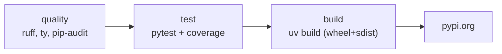

# Python CI guide

uv for everything - venv, sync, lock, tool install, build. The handlers wrap the
standard Python toolchain; the gotchas below are where Python diverges from the
other languages and have each cost a real failure.

## Stages

| Stage | Tools |
|---|---|
| quality | `ruff check`, `ruff format --check`, `ruff check --select S` (security), `ty` (typecheck), `pip-audit`, `vulture` |
| test | `pytest` with coverage |
| build | `uv build` (wheel + sdist) |
| publish | `uv publish` -> pypi.org |



Python publishes to public PyPI only. A legacy `publish.target` in
`.hyperi-ci.yaml` is read by nothing and warns.

## Where the source is

A `src/` holding Python scans `src/`. A flat layout (`mypkg/` or `scripts/` at the root) scans each top-level directory holding Python. Ruff S and D, vulture and coverage need no setting. [quality-gate-tools.md](../quality-gate-tools.md) has the full rule.

## Which Python version CI uses

The project's own declaration, resolved once in the `plan` job and used by every
job after it:

| Order | Source | Notes |
|---|---|---|
| 1 | `.python-version` | A pegged file is someone writing the version down |
| 2 | `requires-python` in `pyproject.toml` | The **floor**, not the newest version satisfying it |
| 3 | The `python-version` workflow input | Only reached when the project declares neither |
| 4 | `runtimes.python` in `versions.yaml` | The fleet default |

The floor is the point. A repo declaring `>=3.12` that is tested on 3.14 never runs its advertised floor. It still publishes a wheel claiming it. uv honours a pegged `.python-version` by itself but resolves a floor to the NEWEST satisfying interpreter. So hyperi-ci computes the floor and hands it over (`hyperi_ci.python_version`).

Nothing to set: declare `requires-python` and CI follows it.

**`ruff` needs no configuration either.** Ruff reads `requires-python` and
targets it, so a project that declares its floor gets lint and formatting for
that floor for free. An explicit `target-version` OVERRIDES it - set one only
to hold ruff BELOW the floor deliberately, as this repo does.

**`UV_PYTHON` is set on the dependency-install step only**, never workflow-wide.
It picks the interpreter for the project venv, which every later `uv run`
inherits. Workflow-wide it would also capture `uvx hyperi-ci` and force the CLI
onto the project's interpreter, which fails outright when the CLI's own
`requires-python` floor is higher.

Rust, Go and TypeScript workflows install the fleet default instead. The
interpreter there runs the hyperi-ci CLI; those projects have no Python of their
own to follow.

## Test parallelism

A hardcoded worker count is right on exactly one machine. hyperi-ci derives it from the host:

```yaml
test:
  python:
    parallel: auto        # unset (default) | false | true | auto | a count
    worker_mem_mb: 1024   # memory planned per worker
```

Unset runs `auto` when pytest-xdist is installed. Without it the suite runs serial with one warning: add pytest-xdist and set `parallel: auto`.

`auto` and `true` size by what is free when the stage starts, capped at 16:

- `cpus` is the smaller of the affinity mask and the cgroup CPU quota.
- On CI: `min(cpus, floor(available * 0.8 / worker_mem_mb))`.
- Elsewhere: `min(max(cpus / 8, min(cpus / 2, cpus - loadavg)), floor(available * 0.5 / worker_mem_mb))`, with the 1-minute load average. The `cpus / 8` floor keeps a busy 32-core box at 4 workers rather than 1.
- `available` is `MemAvailable`, or cgroup v2 `memory.max` minus `memory.current` when lower. Unreadable (macOS) drops the memory bound. Never below 1.

A 4-CPU ARC pod on a 32-core node reports 32 to `os.cpu_count()`, which is what xdist's own `-n auto` reads. On hyperi-ci's 2598-test suite 16 workers take 23.6s against 74.2s serial.

Rust sizes nextest's threads the same way, with `test.rust.thread_mem_mb` (default 2048), through `NEXTEST_TEST_THREADS`. A value already in the environment or a `test-threads` in `.config/nextest.toml` wins.

An explicit number always wins:

- `parallel: false` stays serial, for a suite that binds a fixed port or writes a shared file.
- `parallel: 4` fixes the count.
- `HYPERCI_TEST_WORKERS=4` sets it for one run, `0` for serial. nextest takes it too.
- A project that passes its own `-n` keeps it, and so does one that sets `-p no:xdist`. hyperi-ci reads `test.python.args`, `addopts` in `pytest.toml` / `.pytest.toml` / `pyproject.toml` (`[tool.pytest]` or `[tool.pytest.ini_options]`) / `pytest.ini` / `tox.ini` / `setup.cfg`, and `PYTEST_ADDOPTS`.

hyperi-ci probes the resolved pytest for pytest-xdist (`pytest -VV`).

With hyperi-ci as a dev dependency, a bare `pytest -n auto` gets this count too. Your own conftest hook still wins.

When hyperi-ci supplies the `-n` it adds `--dist worksteal` too. xdist's default `load` mode queues a batch on each worker up front. One worker can sit on slow tests while the rest go idle. Worksteal moves queued tests from a busy worker to one that has run dry.

- **Own mode:** a project that sets `--dist` or `-d` in any of the sources
  above keeps it.
- **Old xdist:** worksteal needs pytest-xdist 3.2 or later. An older one keeps
  the default mode, with a warning.

Coverage survives the split: pytest-cov collects each worker's data and combines
it before reporting, so `--cov-fail-under` measures the same thing it did
serially. Nothing extra goes in `.coveragerc`.

A single unsafe test does not cost a project the whole feature - mark the tests
that must share a worker with xdist's own `@pytest.mark.xdist_group` and run
`--dist loadgroup`.

## Test output

Every run passes pytest `-r` with `s` added to the project's own report chars, so each skip is listed with its reason. It also sets `tmp_path_retention_policy` to `failed`, so a passed test's tmp dir does not sit in `/tmp` for 3 runs.

In CI, both tiers also pass `--durations=25` and write JUnit XML to `test-results/junit.xml` for the Test job's upload. A project that sets any of these options itself keeps its own. Details: [test-tiers.md](../test-tiers.md).

## Test tiers

`--tier full` (or `test.tier: full`) adds `-m "<test.full.python.markers>"`, which replaces the project's `addopts -m`, so tests deselected by marker run too. The key defaults to `""`, every test. Details and the per-run notice: [test-tiers.md](../test-tiers.md).

## Gotchas - read before debugging CI

### Publish must go through `hyperi-ci run build`, not raw `uv build`

Hatchling's sdist includes every git-tracked file. AI-agent directories (`.claude/`, `.cursor/`, ...) and org submodules produce "Invalid tar file" errors. `build.py` injects standard sdist exclusions via a context manager. The Build job **must** call `hyperi-ci run build`, never raw `uv build`, and the release uploads what it built.

### Don't reintroduce a private index (`UV_EXTRA_INDEX_URL`)

uv is first-match-wins across indices: a private index that returns an empty `200` for a package it doesn't host stops resolution dead - "no versions found". We use a single public index, so this cannot bite today. Never add a `UV_EXTRA_INDEX_URL` that mixes a private index with the public one ([lessons.md](../lessons.md#python-uv-index-strategy)).

### hyperi-ci floors scalo

A broken scalo would break CI for every repo, because hyperi-ci is the CI tool for all of them. hyperi-ci declares `scalo>=<floor>` in its `pyproject.toml` and commits `uv.lock`. The lock holds the exact version, and the floor moves only when a new scalo API is adopted.

scalo is on public PyPI. hyperi-ci's own CI uses `uv sync --no-sources` to resolve from PyPI rather than a local editable path.

### The `[metrics]` extra is the service default

Since scalo 2.29.15 the `[metrics]` extra carries both prometheus_client and
the OTel SDK, and a service without it reports `backend=prometheus` while
`/metrics` returns 404. Services declare it. hyperi-ci is a CLI and takes
the opt-out: a bare `scalo` imports cleanly on 2.30.0 with no extras.

## Self-hosting

hyperi-ci is itself a Python project and runs its own pipeline through
`python-ci.yml`. The same handlers that build a consumer's wheel build
hyperi-ci's. Publishing hyperi-ci to PyPI is a `workflow_dispatch` (manual) step
\- see [flow.md](../flow.md).
