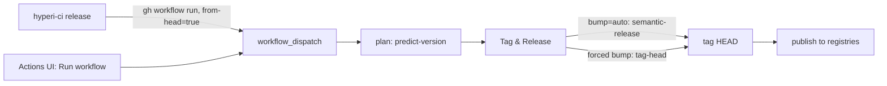

# Releasing on demand

`hyperi-ci push --release` is the normal release path: one CI run, one tag, one release, gated by the `Release: true` trailer. This page covers the cases it does not, and the rules for dispatching a release safely. The pipeline itself is [flow.md](flow.md).

## Release or retry without a junk `fix:`

`push --release` needs a release-worthy commit on HEAD. Two situations break that:

1. **A release run died before Tag & Release** (a transient failure, a container flake). No tag was cut, so `hyperi-ci release vX` has nothing to re-dispatch. `push --bump-patch` does nothing either, because `VERSION` on `main` already equals the target (#25, #35).
2. **You want to release HEAD now**, for docs- or refactor-only work, or without another `Release: true` push.

`hyperi-ci release` covers both (#35). The CLI only dispatches the workflow, and CI does the tagging and publishing. That works under branch protection and from the Actions UI.

| Command | What it dispatches | Use it to |
|---|---|---|
| `hyperi-ci release` | from-head, `bump=auto`: semantic-release picks the version, tags HEAD, publishes | finish a stuck release, or release HEAD when it has release-worthy commits |
| `hyperi-ci release --bump patch\|minor` | from-head with a forced bump: `tag-head` computes last + bump and tags HEAD via `gh api` | release HEAD with no release-worthy commit |
| `hyperi-ci release --version X.Y.Z` | from-head at an exact version, tagging HEAD directly | step past a taken or orphaned tag (#37) |
| `hyperi-ci release <tag>` | the existing tag, as an idempotent retry: publish handlers skip artefacts already in their registry | fill the registries a partial release missed |
| Actions UI -> Run workflow | the same modes, via the `tag` / `from-head` / `bump` inputs | release with no local checkout |

The plan job resolves the version on a dispatch too: semantic-release for `auto`, last + bump for a forced bump. So the build stamps the same version Tag & Release tags. `GITHUB_TOKEN` cuts the tag, and the CLI and the UI button run the same operation.

`push --publish` and `hyperi-ci publish` are old spellings. They still work and warn.

### Which ref a from-head dispatch releases from

The dispatch ref decides whether a from-head run releases (#471). `hyperi-ci release` dispatches on the default branch, but the Actions UI and `gh workflow run --ref` can pick any branch:

| Ref | `bump=auto` | forced `patch` / `minor` / `X.Y.Z` |
|---|---|---|
| main | releases | releases |
| declared prerelease branch (`beta`) | releases on the prerelease sequence (`1.2.0-beta.1`) | validate-only, warns -- a forced bump would cut a stable version |
| any other branch | validate-only, warns | validate-only, warns |

A `tag` dispatch re-publishes from any ref, because the tag already names the commit.

## Merges during a release

A later push never cancels a release run (issue #717). A from-head dispatch, or a push whose head commit carries the `Release: true` (or `Publish: true`) trailer, runs in its own `release-<ref>` concurrency group, and a `tag` dispatch in one named for the tag. Neither cancels in progress. A second release on the same ref waits for the first, and a third replaces the waiting one.

The concurrency key tests the trailer as a substring, `Release: true` or `Release:true`, while Plan matches the line with any spacing. A trailer written `Release:  true` still releases, but its run stays cancellable. A message that only mentions the trailer gets the release group, and Plan still decides.

A merge still breaks a release that lets semantic-release pick the version, because semantic-release tags nothing once the checkout is behind the branch. The image and Helm charts publish before the tag, so the `release-branch-guard` composite runs right before each and stops the run when the branch has moved. Nothing is tagged or published.

- The guard in Tag & Release opens the release-failure issue. The one in the Container job does not.
- A merge after the Container guard and before the Tag & Release guard leaves the pushed image untagged. That span is the image build and push plus the start of Tag & Release: about 5 minutes on dfe-loader run 37891535269, 4 of them the build.
- A merge after the Tag & Release guard, while the charts publish, leaves the charts untagged. The tag guard then stops the registry uploads.
- A re-run whose tag already exists at the built commit passes both guards and finishes that release.
- Recovery: `hyperi-ci release` releases the current head as a new version, and `hyperi-ci release v<x>` re-publishes an existing tag.
- Two auto releases back to back: one of them fails. If the second push landed before the first's tag, the first fails at a guard and the second releases both sets of commits. If after, the first ships, its commit-back moves the branch, and the second fails at Plan ("The branch moved past ...") with no issue.

A forced bump (`--bump patch|minor|X.Y.Z`) tags the commit it built through the API, so a merge does not stop it.

## Operating rules

### Do not dispatch a release while a merge is queued into that repo

A merge landing during a release that lets semantic-release pick the version fails it ([Merges during a release](#merges-during-a-release)). Land the merges, then dispatch. A failed release costs the build time: 35-45 minutes per arch on a Tier 2 Rust release. Issue #228 has the measurements.

### `push --release` drops the trailer when HEAD is already upstream

`push --release` amends HEAD with the `Release: true` trailer and then rebases. Where that commit is already on the remote, the rebase reports `skipped previously applied commit` and takes the upstream copy, which has no trailer. The push then says `Everything up-to-date` and no release runs.

Nothing warns. The tell is `Build: skipped` and `Release tail: skipped` on a run you expected to publish. Use `hyperi-ci release` instead, which dispatches from HEAD and needs no trailer commit.
